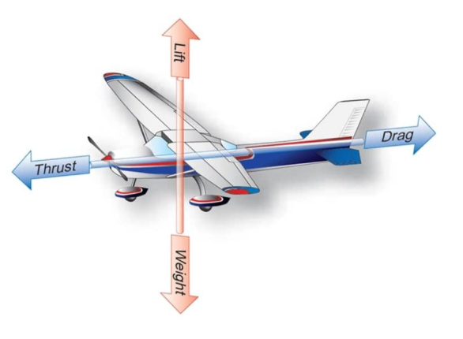

# Fundamental aerodynamic forces

## Overview

In this section we will discuss the fundamental aerodynamic forces. Namely

- Lift
- Drag
- Thrust
- Weight

These four forces govern an aircraft's motion through the air.

## Fundamental aerodynamic forces

The four fundamental aerodynamic forces are:

- Lift
- Drag
- Thrust
- Weight

The following image shows the action of the four forces. Let's see these forces one by one.

### Lift

Lift is the upward aerodynamic force generated by the wings.

### Weight

Lift opposes weight the downward gravitational force acting on the aircraft's mass.  
In general, one wishes to minimize weight while ensuring structural integrity. Reducing aircraft weight improves fuel efficiency and the
aircraft's payload.

### Drag

This is the main force opposing the aircraft's motion through air. We distinguish two types of drag:

- Parasite drag
- Induced drag

The first type of drag is caused by the friction of the aircraft moving through the air. This also includes the resistance of non-lifting parts like fuselage and landing gear.
The induced drag on the other hand is generated by the creation of lift.

### Thrust

Thrust is the forward propulsive force created by the engines that overcomes drag. For an aircraft to maintain steady and level flight thrust must equal drag.
The aircraft will accelerate whenever thrust exceeds drag and decelerate when thrust is less than drag

## Summary

In this section we discussed the four fundamental aerodynamic forces that govern an aircraft's motion through the air:

- Lift: the upward aerodynamic force generated by the wings. It opposes weight.
- Weight: the downward gravitational force acting on the aircraft's mass. Minimizing weight, while ensuring structural integrity, improves fuel efficiency and payload.
- Drag: the main force opposing the aircraft's motion through the air. Parasite drag is caused by friction and by the resistance of non-lifting parts such as the fuselage and landing gear. Induced drag is generated by the creation of lift.
- Thrust: the forward propulsive force created by the engines that overcomes drag.

The forces act in opposing pairs: lift against weight and thrust against drag. In steady and level flight thrust equals drag. The aircraft accelerates when thrust exceeds drag and decelerates when thrust is less than drag.
